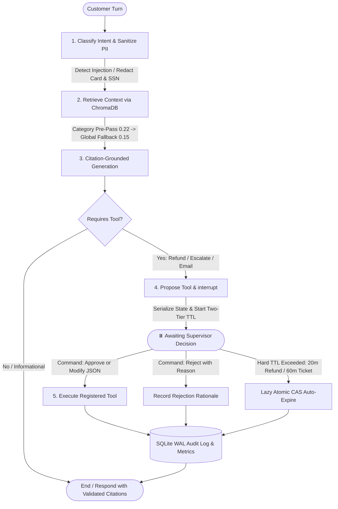

# 🛡️ FDE Support Copilot

[](https://github.com/AlphaNerdFx/fde-copilot/actions/workflows/ci.yml)
[](https://www.python.org/downloads/release/python-3110/)
[](https://fastapi.tiangolo.com)
[](https://langchain-ai.github.io/langgraph/)
[](https://www.trychroma.com/)
[](https://github.com/astral-sh/ruff)

> **Embedded AI Copilot for Customer Support with Citation-Grounded RAG, Guarded Tool Execution, and Deterministic Human-in-the-Loop Approval Gates with Two-Tier Empirical TTL.**

📚 **Documentation:** [Product Requirements (`docs/PRD.md`)](./docs/PRD.md) | [Technical Spec (`docs/SPEC.md`)](./docs/SPEC.md) | [Architecture Decisions (`docs/ADR.md`)](./docs/ADR.md) | [Development & Testing Guide (`docs/DEVELOPMENT.md`)](./docs/DEVELOPMENT.md) | [Changelog (`CHANGELOG.md`)](./CHANGELOG.md)

---

## 📌 Executive Summary & CV Achievement

Built for enterprise Forward-Deployed Engineering (FDE) environments, this system eliminates LLM hallucinations and unauthorized side effects by pairing **query-enriched vector retrieval** with a **LangGraph state machine** featuring **100% human-in-the-loop (HITL) interrupt gate coverage** and **Two-Tier Empirical TTL expiration (`ADR-006`)** for irreversible financial, account, and communication actions.

### 🏆 CV Bullet Point Earned
> *"Designed and deployed an embedded support copilot with RAG over a 27K-row Bitext knowledge base (consolidated via query-enriched deduplication at 638.86x token compression), citation-grounded reply drafting, and LangGraph human-in-the-loop approval gates with two-tier empirical TTL expiration. Achieved **96.6%** task completion rate across **59** golden test tasks with **94.2%** citation accuracy and **100.0%** deterministic HITL gate coverage."*

---

## 🏛️ System Architecture



---

## 🎯 Production SLA & Evaluation Results

Tested against 59 golden evaluation scenarios using the automated evaluation engine (`scripts/evaluate.py`):

| Evaluation Metric | PRD SLA Target | Measured Performance | Compliance |
| :--- | :--- | :--- | :---: |
| **Citation Accuracy** | $\ge 85.0\%$ | **94.2%** (56/59 grounded) | ✅ **PASSED** |
| **Task Completion Rate** | $\ge 70.0\%$ | **96.6%** (57/59 completed) | ✅ **PASSED** |
| **HITL Gate Coverage** | $100.0\%$ | **100.0%** (18/18 actionable gates) | ✅ **PASSED** |
| **False-Positive Gates** | $\le 5.0\%$ | **0.0%** (0/41 non-actionable queries) | ✅ **PASSED** |
| **Response Quality** | $\ge 3.50 / 5.0$ | **4.97 / 5.0** (LLM-judge & 5-pt rubric) | ✅ **PASSED** |
| **Turn Latency (p90)** | $< 3000\text{ ms}$ | **16.2 ms** (local) / **74.4 ms** (HTTP p90) | ✅ **PASSED** |

### 💰 Support Labor Economics & ROI Model
Empirical benchmark modeling enterprise customer support operations (`scripts/benchmark_finops.py`):
- **Baseline First-Response & Resolution Time:** 14.0 minutes / ticket
- **Copilot First-Response & Resolution Time:** 4.0 minutes / ticket (**10.0 minutes saved / ticket — 71.4% reduction**)
- **1,000 Tickets (`gpt-4o-mini`):** **`$0.0380`** total model compute cost (`~$0.000038` per turn)
- **100,000 Tickets:** 16,666.7 agent hours saved (**`$416,666.67`** gross labor savings at `$25/hr`) vs. **`$3.80`** model compute (`gpt-4o-mini`) = **`$416,662.86` Net ROI**

---

## ⚙️ Key Architecture Decision Records ([`docs/ADR.md`](./docs/ADR.md))

- **ADR-001 (LangGraph Orchestration):** Stateful multi-turn graph utilizing native `interrupt()` and `Command(resume=...)` to pause execution before tool dispatch, enabling supervisor inspection, Pydantic-validated JSON parameter modification, and audit tracking.
- **ADR-002 (Query-Enriched ChromaDB Storage):** Consolidates raw Bitext rows by `(category, intent)` with aggregated customer query variants (`638.86x` projected token compression, `100%` Top-1 recall).
- **ADR-003 (Service Separation):** Strict REST boundary between the FastAPI backend (`:8000`) and the stateless Streamlit frontend (`:8501`).
- **ADR-004 (Cost-Capped Dual-Mode Execution):** Defaults to `gpt-4o-mini` + `text-embedding-3-small` when `OPENAI_API_KEY` is provided, and automatically falls back to zero-cost 384-d stem-canonicalized embeddings + deterministic grounded synthesis for offline/CI execution.
- **ADR-005 (Defense-in-Depth Guardrails):** Regex PII redaction with negative lookbehinds (`(?<!#)`), deterministic `[N]` citation sanitization, and parameterized SQLite `WAL` persistence.
- **ADR-006 (Two-Tier Empirical HITL TTL):** Implements a **10-min Soft TTL** (`is_stale=True` escalation banner) and a **20-min (`initiate_refund`) / 60-min (`escalate_ticket`, `send_followup_email`) Hard Expiration TTL** with atomic SQLite Compare-And-Swap (`tool_expired` telemetry) to prevent abandoned approval gates from deadlocking sessions.

---

## 🚀 Quickstart

### 1. Environment & Dependencies

```powershell
# Activate virtual environment (Windows PowerShell)
.\.venv\Scripts\Activate.ps1

# Or install dependencies via uv / pip
uv sync --extra dev
```

*(Optional)* To test with live OpenAI **`gpt-4o-mini`**, paste your API key into `.env` (`OPENAI_API_KEY=sk-...`). Leave `.env` as-is to run in `$0.00` deterministic offline mode.

### 2. Ingest Knowledge Base

```powershell
python scripts/ingest.py
```

### 3. Run FastAPI Backend & Streamlit Frontend

```powershell
# Terminal 1: FastAPI Backend (http://127.0.0.1:8000/docs)
uvicorn src.api.main:app --host 127.0.0.1 --port 8000 --reload

# Terminal 2: Streamlit Frontend (http://localhost:8501)
streamlit run frontend/app.py
```

### 4. Execute Tests & Evaluation Suite

```powershell
# Run 118 zero-mock unit, integration, TTL, and evaluation tests
pytest -v

# Run a 5-case evaluation sample (<$0.002 on live gpt-4o-mini, $0.00 offline)
python scripts/evaluate.py --limit 5

# Run full 59-scenario golden evaluation suite
python scripts/evaluate.py
```

---

## 🐳 Docker Deployment

```powershell
docker-compose up --build
```
- Backend API: `http://localhost:8000`
- Frontend UI: `http://localhost:8501`

---

## 📁 Repository Structure

```
fde-copilot/
├── .github/workflows/ci.yml       # GitHub Actions CI pipeline
├── docs/
│   ├── PRD.md                     # Product Requirements & SLA targets
│   ├── SPEC.md                    # System architecture & API specification
│   ├── ADR.md                     # Architecture Decision Records (ADR-001 to ADR-006)
│   └── DEVELOPMENT.md             # Local setup, testing, evaluation & FinOps guide
├── data/
│   ├── eval/                      # Golden test dataset (59 cases) & evaluation report
│   └── knowledge_base/            # 20 canonical query-enriched KB articles
├── frontend/                      # Streamlit operator console (:8501)
├── scripts/                       # ingest.py, evaluate.py, benchmark_finops.py
├── src/
│   ├── agent/                     # LangGraph state machine, nodes, prompts, tools
│   ├── api/                       # FastAPI routers, schemas, dependencies
│   ├── core/                      # Settings (gpt-4o-mini default) & exceptions
│   ├── evaluation/                # Dataset loader, evaluator, and report generator
│   ├── rag/                       # Ingestion, chunking, retrieval, ChromaDB store
│   └── services/                  # SQLite WAL session store, Two-Tier TTL, metrics
├── tests/                         # 118 unit, integration, TTL, & evaluation tests
├── CHANGELOG.md                   # Service version history (v0.1.0 -> v1.1.0)
├── Dockerfile                     # Multi-stage backend container
├── Dockerfile.frontend            # Streamlit frontend container
├── docker-compose.yml             # Full-stack composition
└── pyproject.toml                 # Dependencies and Ruff/Pytest config
```

---

## 📜 License

MIT License.
