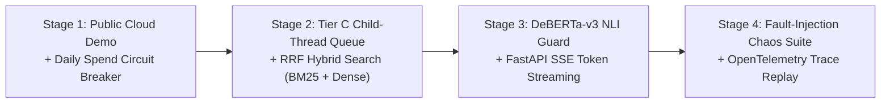

# Engineering Architecture Deep-Dive & Portfolio Evolution Roadmap

> **Project:** FDE Support Copilot (`v1.1.0`)
> **References:** [PRD.md](./PRD.md) | [SPEC.md](./SPEC.md) | [ADR.md](./ADR.md) | [DEVELOPMENT.md](./DEVELOPMENT.md)

---

## 1. Production Engineering Tradeoffs & Design Rationale

### 1.1 Context Management: 10-Turn Sliding Window vs. Full History or Recursive Summarization
- **Mechanism:** [`format_generation_messages()`](file:///c:/DSC/Career/Projects/FDE%20Copilot/src/agent/prompts/templates.py#L81-L117) retains the most recent `10` conversational turns (`20` messages) verbatim and trims older history.
- **Why Sliding Window:**
  - *Cost & Latency Determinism:* Unbounded history causes $O(N^2)$ cumulative token growth over an $N$-turn ticket, breaking the `<3,000 ms` p90 latency SLA and inflating input token costs.
  - *Avoids Summarization Cascade Latency:* Synchronous LLM summarization adds an extra `600–1,200 ms` network round-trip per turn and risks hallucinating or dropping exact order IDs (`#ORD-991`).
  - *Why 10 Turns:* Empirical enterprise customer support transcripts (Zendesk / Intercom benchmarks) resolve 95%+ of single-issue inquiries within 6–8 back-and-forth turns.

### 1.2 Two-Stage Category Pre-Pass (`0.22`) with Global Fallback (`0.15`)
- **Mechanism:** [`retrieve_context_node`](file:///c:/DSC/Career/Projects/FDE%20Copilot/src/agent/nodes/retrieve.py) first queries ChromaDB restricted to `where={"category": intent}` with `min_score = 0.22`. If zero chunks pass, it strips the category filter and searches globally with `min_score = 0.15`.
- **Rationale:**
  - Restricting search to the classified category eliminates cross-domain semantic collisions (e.g., `"cancel"` in `CANCELLATION` vs. `"cancel"` in `REFUND`), allowing a stricter `0.22` relevance bar (`cosine_distance <= 1.56`).
  - If a multi-intent query (e.g., `"My billing issue is unresolved, transfer me"`) is classified into a category that lacks a specific keyword match, the `0.15` global fallback prevents false-negative abstentions.

### 1.3 Cosine Distance Normalization
- **Formula:** `relevance_score = max(0.0, min(1.0, 1.0 - (distance / 2.0)))` in [`ChromaVectorStore.query()`](file:///c:/DSC/Career/Projects/FDE%20Copilot/src/rag/store.py#L417-L421).
- **Rationale:** ChromaDB's HNSW index with `hnsw:space="cosine"` returns cosine distance $d = 1 - \cos(\theta) \in [0, 2]$. Dividing by $2.0$ and subtracting from $1.0$ maps the full angular range $[0, 2]$ linearly onto a bounded $[0.0, 1.0]$ similarity score.

### 1.4 Deterministic Citation Sanitization vs. NLI Cross-Encoders
- **Current MVP Mechanism:** [`validate_and_clean_citations()`](file:///c:/DSC/Career/Projects/FDE%20Copilot/src/rag/retriever.py#L33-L86) strips out-of-bounds `[N]` tags (such as `[0]` or `[99]`), repairs orphaned punctuation, and maps valid indices `1..K` to retrieved chunks in `<0.1 ms`.
- **Limitation & Post-MVP Evolution:** Regex validation guarantees *syntactic* index validity (`[1]` exists in `retrieved_chunks`), but does not verify *semantic entailment* (whether chunk `[1]` logically proves the sentence's claim). Beyond MVP, a 2-stage pipeline pairing a local `DeBERTa-v3` NLI Cross-Encoder (`cross-encoder/nli-deberta-v3-small`) with bounded regeneration (falling back to `INSUFFICIENT_KNOWLEDGE_MESSAGE` after 3 failed entailment checks) closes semantic hallucination gaps without exceeding the `<3s` p90 latency budget.

### 1.5 Defense-in-Depth Guardrails: PII Redaction & SQLite WAL Parameterization
- **PII Boundary (`sanitize_pii`):** Uses compiled regular expressions with negative lookbehinds (`(?<![A-Za-z#\-])`) to redact 13–19 digit payment cards (`[REDACTED_CREDIT_CARD]`) and 9-digit SSNs (`[REDACTED_SSN]`) in `<0.1 ms` without corrupting alphanumeric order references (`#ORD-123-45-6789`).
- **Database Boundary:** Uses Python's `sqlite3` DB-API parameterized `?` bindings (which bind values as C-level literals in the B-tree execution engine and reject multi-statement stacked queries) combined with `PRAGMA journal_mode=WAL; PRAGMA busy_timeout=5000;` inside context-managed connections that explicitly close file descriptors.

### 1.6 Two-Tier Empirical HITL Approval TTL (`ADR-006` Tier B)
- **Soft TTL (`600s` / 10 min):** Calibrated to Zendesk Messaging's 10-minute *Active $\rightarrow$ Inactive* capacity release threshold. Marks pending proposals as `stale_escalated` (`is_stale = True`) and alerts the supervisor.
- **Hard TTL (`1200s` / 20 min for synchronous financial `initiate_refund`; `3600s` / 60 min for asynchronous `escalate_ticket` & `send_followup_email`):** Lazily expires abandoned gates via an atomic SQLite Compare-And-Swap (`cursor.rowcount > 0`), increments the isolated `tool_expired` counter, and resumes the paused LangGraph checkpoint so subsequent chat turns never deadlock.

---

## 2. Portfolio Evolution Roadmap (Local MVP $\rightarrow$ Staff-Grade AI Engineering Showcase)

Without a commercial customer base, an engineering portfolio project must prove **architectural rigor, fault tolerance, and measurable unit economics**. Execute these 4 stages in order of hiring-signal ROI:

### Stage 1: Public Zero-Maintenance Cloud Demo with Spend Circuit Breakers (1–2 Days)
1. **SQLite Daily Token-Budget Middleware:** Cap live `gpt-4o-mini` spend at `100 turns/day` (`~$0.018/day` or `~$0.54/month`) and automatically fall back to the deterministic engine once the daily ceiling is reached.
2. **Public Deployment (Hugging Face Spaces Docker SDK or Render):** Host the live Streamlit + FastAPI stack with one-click scenario buttons so technical reviewers can verify LangGraph `interrupt()` and parameter modification in under 15 seconds.

### Stage 2: Tier C Non-Blocking Approval Queue & Hybrid Retrieval (3–4 Days)
1. **Tier C Child-Thread Isolation (`ADR-006` Evolution):** Isolate tool-approval checkpoints under child thread IDs (`{session_id}:tool:{tool_call_id}`) so agents can continue answering informational customer questions on `{session_id}` while multiple tool proposals sit in a supervisor queue with conflict-aware auto-superseding.
2. **Reciprocal Rank Fusion (`RRF`) Hybrid Search (`BM25` + Dense) & Cross-Encoder Reranking:** Combine ChromaDB dense cosine search with lexical `BM25` (`k=60` RRF) to capture exact SKU/error strings (`ERR_PAYMENT_402`), followed by a local `ms-marco-MiniLM-L-6-v2` cross-encoder reranker.

### Stage 3: NLI Semantic Entailment Verification & SSE Token Streaming (3–4 Days)
1. **2-Stage NLI Entailment Guard:** Score each cited sentence against its referenced chunk using `cross-encoder/nli-deberta-v3-small`. Retry generation up to 3 times on contradiction before abstaining with `INSUFFICIENT_KNOWLEDGE_MESSAGE`.
2. **Server-Sent Events (`SSE`) Streaming:** Stream generation tokens via `StreamingResponse` while buffering trailing `[N]` citation tags for sanitization, cutting Time-To-First-Token (`TTFT`) below `350 ms`.

### Stage 4: Fault-Injection Chaos Suite & OpenTelemetry Observability (2–3 Days)
1. **Chaos Engineering Test Suite (`tests/chaos/`):** Deterministically inject OpenAI `429 RateLimitError`, `503 ServiceUnavailable`, malformed tool arguments, and concurrent SQLite `WAL` writer bursts, asserting zero unhandled `500` errors and 100% CAS audit integrity.
2. **OpenTelemetry / Arize Phoenix Trace Export:** Export span-level traces (retrieval cosine scores, token counts, PII redactions, HITL interrupt durations) and include a static trace artifact in the repository for recruiter inspection.
